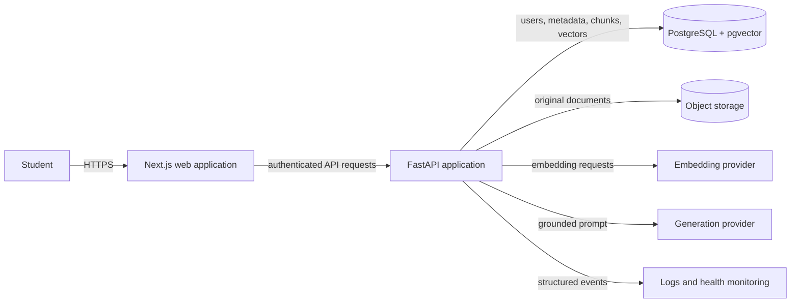
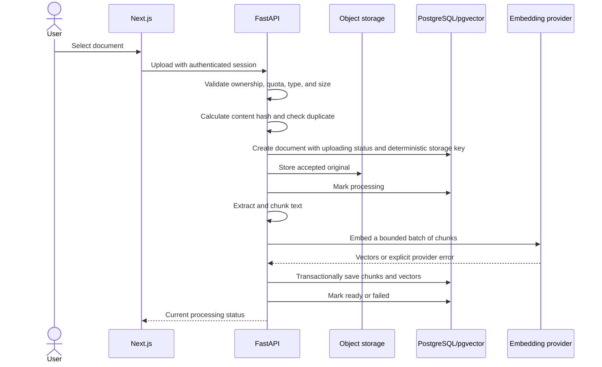
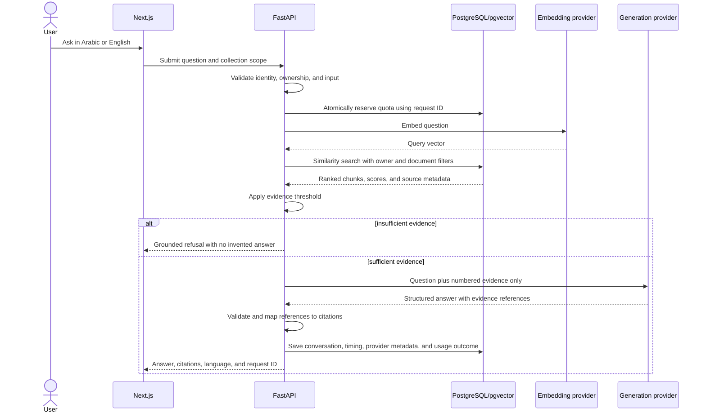

# Bilingual Knowledge Platform — Initial Architecture

## Decision summary

Evolve the existing repository into a web platform while preserving the
verified RAG behavior as domain logic. Use a Next.js frontend, a FastAPI
backend, PostgreSQL with pgvector, object storage, and replaceable model
providers.

The initial hosted demo favors services with bounded free plans:

- Next.js frontend on Vercel Hobby.
- FastAPI backend on a free Python web service such as Render.
- Supabase Free for PostgreSQL, pgvector, authentication, and object storage.
- A free hosted generation and embedding provider for public demo material.
- Ollama and a local embedding model as the private local-development path.

Provider names and model identifiers belong in configuration, not business
logic. Free tiers can change, so no product behavior should depend on one model
vendor.

## System context



## Trust boundaries

- The browser is untrusted. It never receives service-role database keys or
  model-provider secrets.
- The API validates the authenticated identity, input, ownership, and quota on
  every protected operation.
- Normal user operations propagate the verified user JWT to a database role
  that is subject to PostgreSQL row-level security. Deployment and migration
  credentials are never used for normal API requests. Application ownership
  checks remain required.
- Original documents and retrieved passages cross the hosted-provider boundary
  only after the user has explicitly acknowledged the named providers, data
  sent to them, and linked current terms.
- Logs contain identifiers, timings, status, and error categories—not document
  bodies, prompts, answers, access tokens, or secrets.

## Ingestion flow



The MVP deliberately uses bounded synchronous processing rather than claiming
a durable background queue that the free deployment does not provide. Upload
size and page limits must keep work within the configured request deadline.
If a request is interrupted, a later retry may recover a stale `uploading` or
`processing` record using the stable content hash and storage key; it must not
duplicate chunks. A replacement is considered ready only after all new chunks
and vectors are stored successfully.

If object storage succeeds but a later step fails, the document record remains
the source of truth and exposes retry or delete. If storage fails, the record is
marked failed. A reconciliation task, which may run on startup or an authorized
maintenance request, reports and removes objects with no matching document and
marks records whose expected object is missing. Deletion removes the source
object and cascades through chunks, citations, and ingestion attempts.

## Question and answer flow



## Application boundaries

```text
apps/
  web/                 Next.js user interface
  api/                 FastAPI routes, dependencies, and request schemas
packages/
  rag/                 retrieval, grounding, citations, and provider contracts
  document_processing/ extraction, normalization, hashing, and chunking
infrastructure/
  database/            schema, migrations, row-level security, and seeds
docs/                   product, architecture, operations, and evaluation notes
tests/
  backend/              unit and integration tests
  e2e/                  critical browser journeys
```

This is the intended scaffold for Week 1 Day 6, not a claim that the current
CLI already has this layout. The migration should be incremental: first extract
provider-neutral domain services, then add the API, persistence, and web app.

## Core interfaces

The exact Python types will be decided during backend implementation, but the
boundaries must express these capabilities:

```text
EmbeddingProvider.embed_documents(texts) -> vectors
EmbeddingProvider.embed_query(text) -> vector

GenerationProvider.generate(question, evidence, language) -> grounded draft

DocumentRepository.create/update/delete/get_for_user(...)
ChunkRepository.replace_for_document/search_for_user(...)
ConversationRepository.append_message/list_for_user(...)
```

Provider adapters translate external timeouts, quota errors, authentication
errors, and invalid responses into explicit application errors. They must not
silently fall back to an ungrounded answer.

## Initial data model

| Entity | Purpose | Important relationships |
|---|---|---|
| `users` | Authenticated identity and profile | Owns documents and conversations |
| `documents` | Source metadata, hash, storage path, and processing status | Belongs to one user; has many chunks |
| `chunks` | Extracted text, order, source location, and vector | Belongs to one document and owner |
| `conversations` | Saved chat scope and title | Belongs to one user; has many messages |
| `messages` | Question, answer/refusal, language, and timing | Belongs to one conversation |
| `citations` | Maps an answer claim to a supporting chunk | Belongs to an assistant message and chunk |
| `ingestion_jobs` | Retry-safe processing attempts and error category | Belongs to one document |
| `usage_reservations` | Durable per-user quota reservation and provider outcome | Unique request ID prevents duplicate provider calls |
| `evaluation_runs` | Reproducible model, settings, dataset, and metrics | Has many evaluation results |
| `audit_events` | Security-relevant actions without sensitive contents | Associated with an actor and resource |

Database migrations, indexes, deletion rules, and row-level-security policies
will be specified with the Week 2 schema rather than guessed in this document.

Quota reservation is a database transaction, not a process-local counter. It
atomically checks the user's current period, creates a reservation with a
unique request ID, and rejects work when the limit is reached. A definitely
rejected call may release its reservation; a timeout with an unknown provider
outcome remains counted to prevent retry storms from exceeding the external
quota. Reconciliation records the final success or failure for observability.

## Free-tier behavior

- A cold backend may take longer to answer; readiness is distinct from basic
  process health.
- Persistent documents live in object storage and PostgreSQL, never on the
  backend instance filesystem.
- Quotas are atomically reserved in PostgreSQL before uploads, embeddings, and
  generation.
- When a provider quota is exhausted, the API returns a stable quota error and
  does not attempt a paid model.
- Anonymous users use only a bounded sample collection; personal uploads
  require authentication.
- Model and embedding identifiers are environment configuration with validated
  startup defaults.
- Interactive requests use the user's verified JWT with a database role that
  honors row-level security. Elevated deployment credentials are restricted to
  migrations and narrowly scoped maintenance, never ordinary user queries.

## Alternatives considered

### Keep Chroma as the hosted database

Rejected for the first hosted design. The current local Chroma integration is
useful for learning and local verification, but a multi-user service also needs
durable relational ownership, authorization, conversations, jobs, and audit
records. PostgreSQL with pgvector keeps those relationships and vectors within
one transactional system.

### Run only local open models

Retained as a development mode, not the public demo architecture. Ollama avoids
per-request model charges and protects local documents, but a public deployment
still needs continuously available compute capable of running the model.

### Put the entire backend in frontend serverless functions

Not selected. It would reduce the number of deployed services, but Python
document processing, long ingestion work, explicit API boundaries, and backend
portfolio value justify a separate FastAPI service.

### Rewrite the project from zero

Rejected. The existing project contains independently built, tested lessons
about chunk identity, idempotency, retrieval thresholds, provider failures, and
grounding. We will preserve those decisions while replacing infrastructure at
clear interfaces.

## Architecture qualities to verify

- **Correctness:** citations refer to retrieved chunks and refusals occur below
  the evidence threshold.
- **Security:** all reads and mutations enforce ownership; secrets and document
  contents stay out of logs. Negative tests cover metadata, vector search,
  storage, citations, and deletion across two different users.
- **Reliability:** ingestion retries are idempotent and external failures are
  explicit.
- **Replaceability:** hosted and local model providers implement the same
  application contracts.
- **Observability:** each request has an ID, categorized outcome, duration, and
  provider metadata without sensitive content.
- **Accessibility:** Arabic RTL and English LTR behavior are first-class UI
  requirements.
- **Cost control:** application quotas fail closed before an external paid path
  can be used.

